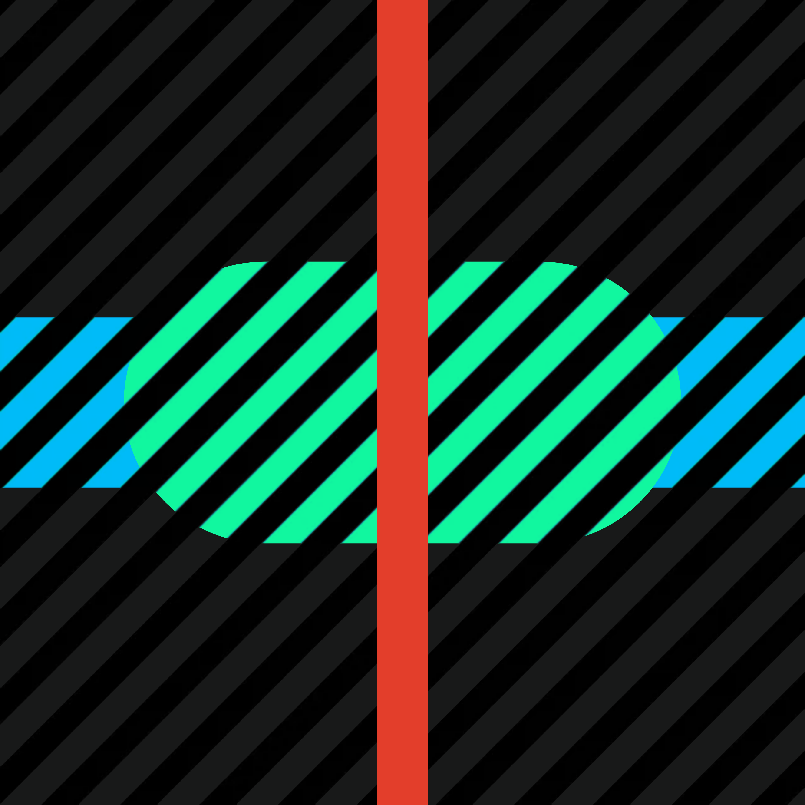
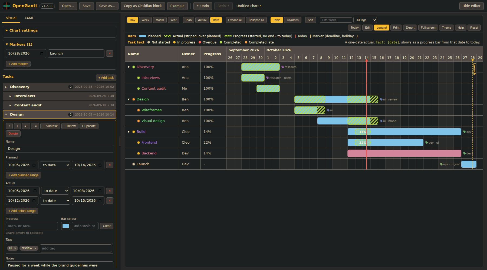
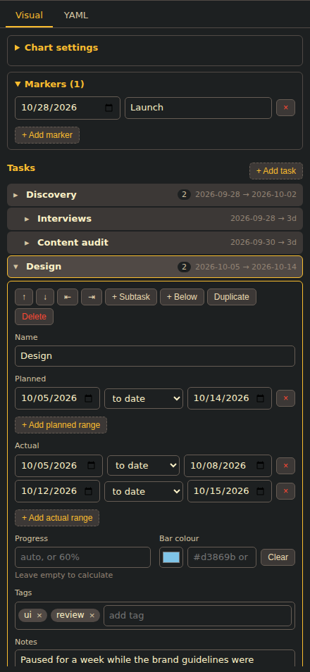
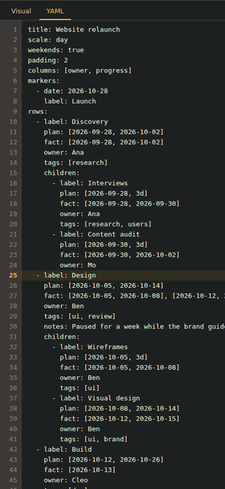
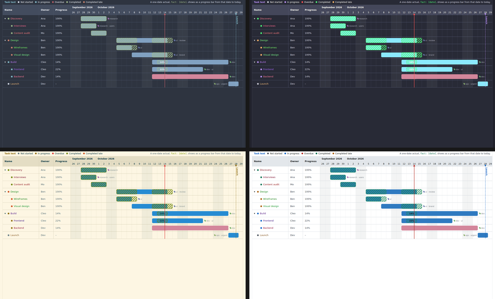
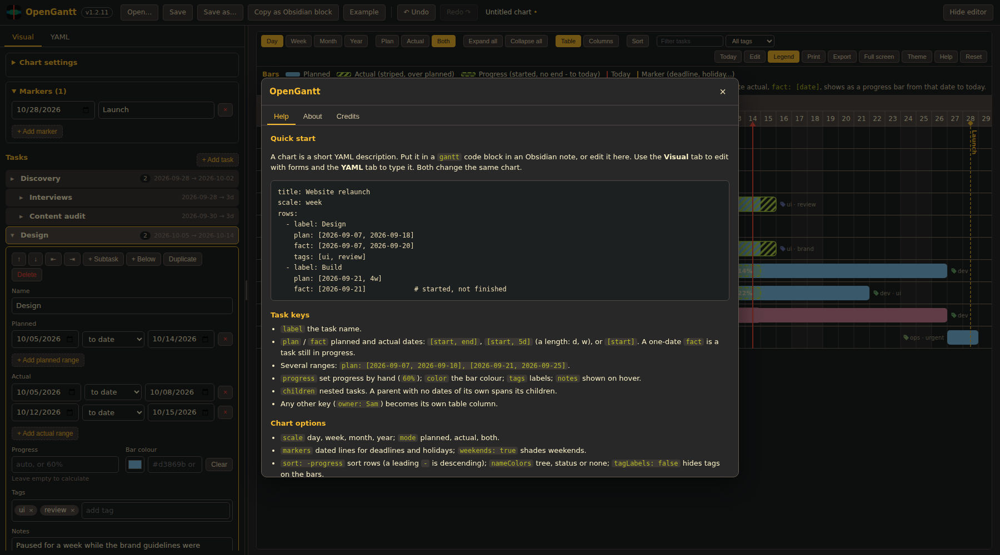
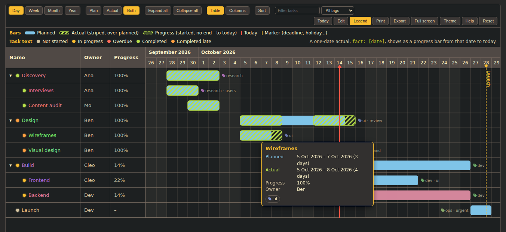
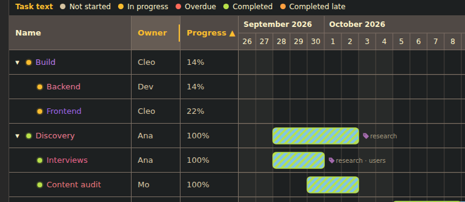
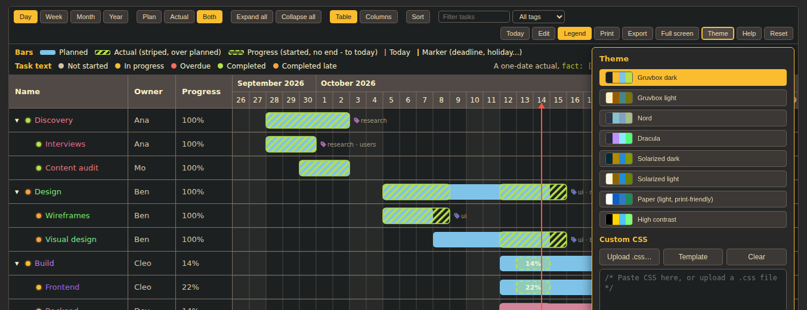

<h1>
  
  OpenGantt
</h1>

[](https://jebbycodes.github.io/OpenGantt/)
[](https://community.obsidian.md/plugins/gantt)
[](https://github.com/JebbyCodes/OpenGantt/releases)
[](https://github.com/JebbyCodes/OpenGantt/actions/workflows/release.yml)
[](https://github.com/JebbyCodes/OpenGantt/blob/main/LICENSE)
[](https://github.com/JebbyCodes/OpenGantt/stargazers)

> A lightweight, YAML-driven Gantt chart for the browser, Obsidian, and desktop.

**[🌐 OpenGantt Website](https://jebbycodes.github.io/OpenGantt/)** · **[📝 Obsidian Plugin](https://community.obsidian.md/plugins/gantt)** · **[📦 GitHub Releases](https://github.com/JebbyCodes/OpenGantt/releases)**

OpenGantt turns a small YAML definition into an interactive Gantt chart with **planned work, actual work, multiple start/end ranges per task, live progress, hierarchical tasks, custom columns, printing, and export**.

It can be used in three ways:

* 🌐 **Standalone web app** — use OpenGantt directly in your browser or as a self-contained HTML application.
* 📝 **Obsidian plugin** — embed Gantt charts directly inside Markdown notes.
* 🖥️ **Desktop application** — package the same frontend as a native Tauri application.

The chart data remains plain YAML, making it easy to read, edit, search, diff, back up, and keep alongside the project it describes.

<p align="center">
  
</p>

<sub>The visual editor on the left (the YAML is one tab away) and the chart on the right: planned and actual bars, a task with two separate actual ranges, tags beside the bars, a deadline marker, shaded weekends and the today line. Names are coloured by branch, with a dot for status.</sub>

---

## ✨ Features

### 📅 Gantt charts

* Planned and actual task bars
* **Multiple planned and actual ranges per task** (phased work, pauses, restarts, re-planning)
* Durations instead of end dates: `plan: [2026-09-07, 5d]`
* Parent rows that span their subtasks automatically
* Manual progress and per-task bar colours
* Markers for deadlines, holidays and reviews, and weekend shading
* Live progress for open tasks
* Day, week, month, and year scales
* Today indicator
* Task hierarchy with expandable/collapsible rows
* **Tags**, shown quietly beside the bars and in full in the tooltip
* **Family colours for task names**: each branch gets its own colour and subtasks drift gradually from it
* Milestones
* Planned vs. actual comparison
* Actual bars with optional diagonal hatching
* Automatic progress calculation
* Task status and schedule variance

### 📊 Customisable task table

The table alongside the timeline can display:

* Task name
* Progress
* Planned start/end dates
* Actual start/end dates
* Every planned and actual range of a task
* Planned duration
* Actual duration
* Tags
* Schedule variance
* Status
* Notes
* Custom YAML fields

Columns can be reordered, hidden, or added from the chart interface. **Drag the edge of a heading to resize a column**; columns also grow to fit their text on their own. **Click a heading to sort.**

Any additional property placed on a task automatically becomes available as a custom column.

### 📝 YAML-driven

Charts are defined using simple YAML:

```yaml
scale: week
mode: both
title: Example project

rows:
  - label: Stage 1 - Planning
    plan: [2026-09-07, 2026-09-12]
    fact: [2026-09-07, 2026-09-14]

    children:
      - label: Collect requirements
        plan: [2026-09-07, 2026-09-09]
        fact: [2026-09-07, 2026-09-10]

      - label: Write specification
        plan: [2026-09-10, 2026-09-12]
        fact: [2026-09-11, 2026-09-14]

  - label: Stage 2 - Development
    plan: [2026-09-15, 2026-10-10]
    fact: [2026-09-15]

  - label: Stakeholder reviews
    plan: [2026-09-17, 2026-09-18], [2026-09-30, 2026-10-01]
    fact: [2026-09-17, 2026-09-19], [2026-10-02, 2026-10-03]
```

Because the chart is represented as text, it works particularly well with Git, Markdown, Obsidian, and other text-based workflows.

### ✏️ Two ways to edit, one chart

* **Visual editor**: forms for every option, task, date range, tag and marker, with add, remove, move, indent, outdent and duplicate. Nothing to remember.
* **YAML editor**: with **line numbers**, a highlighted current line, the offending line marked when the YAML has an error, <kbd>Tab</kbd> indentation and <kbd>Ctrl</kbd>+<kbd>/</kbd> to comment.
* Both edit the same text and stay in step. Undo and redo cover both.
* Works the same in the standalone app and inside Obsidian (the **Edit** button opens the editors in a dialog and saves back into the note).

<p align="center">
  
  &nbsp;
  
</p>

### 🎨 Look and feel

* **Eight colour themes** (Gruvbox dark and light, Nord, Dracula, Solarized dark and light, Paper, High contrast), plus **Match Obsidian** inside Obsidian.
* **Your own CSS**: upload a `.css` file or paste it in; download a template listing every variable.
* A **Help** dialog with a YAML cheat sheet and keyboard shortcuts, an **About** page showing the version, and **Credits** for everything the app builds on.
* Resizable where it matters: table columns, the editor/chart divider, the chart height, and the popovers.

<p align="center">
  
</p>

<p align="center">
  
</p>

### 🔎 Finding your way around a big chart

* **Sort** rows by any column, ascending or descending. Subtasks stay under their parent; blanks always go last.
* **Filter** by text (name, notes, tags) or by tag; matching tasks keep their parents.
* **Tags** appear as a small label beside each task's bars and as chips with a tag icon in the tooltip.
* A **Today** button, collapse/expand all, and double-click a task to edit it.

<p align="center">
  
</p>

---

## 🚀 Quick start

### 🌐 Web version

**[Open OpenGantt in your browser →](https://jebbycodes.github.io/OpenGantt/)**

The web version runs directly in your browser with no installation required.

It provides:

* **Visual** and **YAML** editing (with line numbers), plus undo and redo
* Open
* Save
* Save As
* Obsidian block copying
* Example chart
* Printing
* PNG export
* SVG export
* CSV export
* Timeline scaling
* Plan / Actual / Both modes
* Table and column controls (resize, reorder, sort)
* Filter, tags and themes
* Help, About and Credits

The repository also contains a self-contained standalone application:

```text
dist/Gantt.html
```

Simply open it in a modern browser.

No server is required and the standalone build does not need an internet connection.

### 📝 Obsidian

OpenGantt is available through the **[Obsidian Community Plugins](https://community.obsidian.md/plugins/gantt)**.

Install it from:

**Settings → Community plugins → Browse → OpenGantt**

Alternatively, you can build and install the plugin manually using the development instructions below.

### 🖥️ Desktop

OpenGantt can also be packaged as a native desktop application using **[Tauri 2](https://tauri.app/)**.

See [Building the desktop application](#building-the-desktop-application) for instructions.

### Keyboard shortcuts

| Shortcut                       | Action  |
| ------------------------------ | ------- |
| `Ctrl` / `Cmd` + `O`           | Open    |
| `Ctrl` / `Cmd` + `S`           | Save    |
| `Ctrl` / `Cmd` + `Shift` + `S` | Save As |
| `Ctrl` / `Cmd` + `P`           | Print   |
| `Ctrl` / `Cmd` + `Z`           | Undo (outside the YAML box, which has its own) |
| `Ctrl` / `Cmd` + `Shift` + `Z` or `Ctrl` + `Y` | Redo |
| `Tab` / `Shift` + `Tab`        | Indent / outdent lines in the YAML editor |
| `Ctrl` / `Cmd` + `/`           | Comment or uncomment lines in the YAML editor |
| `Esc`                          | Close a dialog, popover or full screen |

---

# 📦 Installation

## Requirements

### For using the web application

No installation is required.

Open:

**https://jebbycodes.github.io/OpenGantt/**

in a modern browser.

Alternatively, download or clone the repository and open:

```text
dist/Gantt.html
```

### For using the Obsidian plugin

Install OpenGantt from the **[Obsidian Community Plugins](https://community.obsidian.md/plugins/gantt)**.

No additional dependencies are required for normal plugin use.

### For development

The JavaScript build system requires:

* [Node.js](https://nodejs.org/) LTS
* npm

The Obsidian plugin build uses `esbuild`.

### For building the desktop application

The desktop version uses:

* Node.js
* npm
* Rust
* Cargo
* Tauri 2

The Rust project specifies a minimum Rust version of **1.77.2**.

---

# 🛠️ Development setup

Clone the repository:

```bash
git clone https://github.com/JebbyCodes/OpenGantt.git
cd OpenGantt
```

Install the JavaScript dependencies:

```bash
npm install
```

The dependencies and available npm scripts are defined in `package.json`.

---

# 🧱 Building

OpenGantt has separate build processes for the standalone application and the Obsidian plugin.

## Standalone application

Build the browser version with:

```bash
npm run build:app
```

This runs `build-app.mjs`.

The build produces:

```text
dist/
├── Gantt.html
└── index.html
```

`Gantt.html` is the standalone application intended to be opened directly. It is committed to the repository, so the app works straight after cloning.

`index.html` is an identical copy that Tauri looks for in its frontend directory. It is generated on every build and is not committed.

### Offline operation

The standalone application bundles its required JavaScript, CSS, and `js-yaml` dependency into the generated HTML.

Nothing needs to be downloaded when the generated file is opened.

---

## Obsidian plugin

Build the Obsidian plugin with:

```bash
npm run build
```

The build produces:

```text
main.js
styles.css
```

`manifest.json` is already present in the repository and is copied alongside those files when the optional vault path is supplied.

The build script bundles the plugin while leaving Obsidian, Electron, CodeMirror, and Lezer packages external because they are provided by the Obsidian host application.

### Automatically install into an Obsidian vault

Pass the path to your Obsidian vault:

```bash
npm run build -- "/path/to/your/vault"
```

For example, on Windows:

```powershell
npm run build -- "C:\Users\YourName\Documents\Obsidian Vaults\My Vault"
```

The build script installs the plugin into:

```text
<vault>/.obsidian/plugins/gantt/
```

The resulting directory contains:

```text
<vault>/.obsidian/plugins/gantt/
├── main.js
├── manifest.json
└── styles.css
```

### Manual installation

If you build without specifying a vault:

```bash
npm run build
```

copy:

```text
main.js
manifest.json
styles.css
```

to:

```text
<vault>/.obsidian/plugins/gantt/
```

Then open Obsidian and go to:

**Settings → Community plugins → enable OpenGantt**

---

# 🖥️ Building the desktop application

OpenGantt uses **[Tauri 2](https://tauri.app/)** for its desktop shell.

The Tauri configuration specifies:

* Application name: `OpenGantt`
* Version: `1.2.0`
* Frontend directory: `dist/`
* Frontend build command: `npm run build:app`

After installing the required Rust/Tauri tooling, build the desktop application with:

```bash
npx tauri build
```

Tauri will first run:

```bash
npm run build:app
```

and then package the generated `dist/` frontend into the native application.

For development with the Tauri shell, build the frontend first (`dist/index.html` is generated, not committed):

```bash
npm run build:app
npx tauri dev
```

The exact native output location depends on the platform and Tauri's build configuration.

---

# 🧪 Testing

Run the project's test suite with:

```bash
npm test
```

The test command currently runs tests covering:

* Model behaviour
* Timeline calculations
* Table columns
* Export functionality
* Multiple planned/actual ranges
* Durations, parent rollups, manual progress, colours, markers and weekends
* Reading and writing YAML for the visual editor, and its row operations
* Sorting, filtering, tags, name colours, themes (including contrast ratios) and version consistency
* Browser tests of the real interface (below)

The individual test files are:

```text
test/model.test.mjs
test/timeline.test.mjs
test/columns.test.mjs
test/export.test.mjs
test/segments.test.mjs
test/features.test.mjs
test/serialize.test.mjs
test/arrange.test.mjs
test/browser/ui.test.py
```

The available test command is defined directly in `package.json`.

### Browser tests

`test/browser/ui.test.py` drives the built standalone app in headless Chromium: column resizing and auto-fit, sorting, filtering, the visual editor round trip, undo, themes and custom CSS, the dialogs, the divider, line numbers, and the Obsidian edit dialog writing back into a (fake) note. It needs Python with Playwright:

```bash
pip install playwright && playwright install chromium
npm run build:app
npm run test:browser
```

---

# 📐 YAML reference

## Top-level options

The following options can be placed alongside `rows`:

| Option      | Values                         |      Default | Description                      |
| ----------- | ------------------------------ | -----------: | -------------------------------- |
| `scale`     | `day`, `week`, `month`, `year` |        `day` | Timeline scale                   |
| `mode`      | `plan`, `actual`, `both`       |       `both` | Which bars to display            |
| `height`    | `200`–`1600`                   |        `520` | Chart height in pixels           |
| `padding`   | `0`–`365`                      |          `7` | Empty days around the chart      |
| `hatch`     | `true`, `false`                |       `true` | Diagonal hatching on actual bars |
| `progress`  | `true`, `false`                |       `true` | Show progress for open actuals   |
| `collapsed` | `true`, `false`                |      `false` | Start with parent rows collapsed |
| `columns`   | Column names                   | Saved layout | Select and order table columns   |
| `table`     | `true`, `false`, `hidden`      | Saved layout | Show or hide the task table      |
| `title`     | Text                           |    File name | Title used for print/export      |
| `weekends`  | `true`, `false`                |      `false` | Shade Saturdays and Sundays (day scale) |
| `sort`      | A column, optionally `-` or `desc` |     none | Sort rows, e.g. `planStart`, `-progress`, `name desc` |
| `nameColors` | `tree`, `status`, `none`      |       `tree` | How task names are coloured |
| `tagLabels` | `true`, `false`                |       `true` | Show tags beside the bars |
| `markers`   | List of dates with labels      |         none | Vertical lines for deadlines, holidays, reviews |

### Example

```yaml
scale: month
mode: both
height: 700
padding: 14
hatch: true
progress: true
collapsed: false
title: EPQ Project

rows:
  - label: Research
    plan: [2026-09-07, 2026-10-10]
    fact: [2026-09-07]
```

---

## Task properties

Each task can contain:

| Property   | Description             |
| ---------- | ----------------------- |
| `label`    | Task name               |
| `plan`     | Planned start/end dates, or a list of ranges |
| `fact`     | Actual start/end dates, or a list of ranges  |
| `children` | Nested tasks            |
| `notes`    | Additional information  |
| `progress` | Progress set by hand, e.g. `60` or `60%` |
| `color`    | Bar colour, e.g. `"#e06c75"` or `teal` |
| `tags`     | Labels, e.g. `[design, urgent]` (or `design, urgent`) |

Additional properties become custom table columns.

For example:

```yaml
rows:
  - label: Write literature review
    plan: [2026-10-01, 2026-10-14]
    fact: [2026-10-02, 2026-10-17]
    owner: Alex
    priority: High
```

This automatically makes `owner` and `priority` available as table columns.

---

## Planned dates

A normal planned task uses two dates:

```yaml
plan: [2026-10-01, 2026-10-14]
```

A single planned date creates a milestone:

```yaml
plan: [2026-10-14]
```

---

## Actual dates

A completed or ongoing task can have an actual start and end:

```yaml
fact: [2026-10-02, 2026-10-17]
```

An open task can contain only its actual start:

```yaml
fact: [2026-10-02]
```

Open actual tasks extend to the current date and can display their calculated progress.

---

## Multiple ranges

Work does not always happen in one continuous block. Give `plan` and/or `fact` a **list of ranges** when a task is done in phases, paused and resumed, or re-planned:

```yaml
rows:
  - label: Build prototype
    plan:
      - [2026-09-07, 2026-09-12]
      - [2026-09-21, 2026-09-25]      # second planned phase after a gap
    fact:
      - [2026-09-07, 2026-09-10]
      - [2026-09-14, 2026-09-18]      # paused, then resumed
      - [2026-09-28]                  # still open
```

The same thing with each range in its own brackets on one line:

```yaml
plan: [2026-09-07, 2026-09-12], [2026-09-21, 2026-09-25]
fact: [2026-09-07, 2026-09-10], [2026-09-14, 2026-09-18], [2026-09-28]
```

Plain YAML does not allow that, so OpenGantt rewrites such `plan:` / `fact:` lines to the standard nested form before parsing. The standard form, `plan: [[2026-09-07, 2026-09-12], [2026-09-21, 2026-09-25]]`, works too, and your saved text is never altered.

How it behaves:

* Each range is drawn as its own bar in the same row. The gaps between ranges stay empty.
* The single form (`plan: [start, end]`) still works, and you can mix both forms in one chart. A list with one range is the same as the single form.
* Ranges are sorted by start date, so they can be written in any order. A range written end-first is swapped, and a range with only one date is a single day.
* In `fact`, a range with only a start date is an **open** range, but only when it is the last one. It becomes the live progress bar. A start-only range earlier in the list is a one-day range.
* Ranges may overlap; days covered twice are counted once in the duration columns.

**Whole-task values.** The table, status and variance treat the task as one span:

| Value                       | With several ranges                                                                 |
| --------------------------- | ----------------------------------------------------------------------------------- |
| Start planned / actual      | The earliest start                                                                  |
| End planned / actual        | The latest end (`ongoing` while the last actual range is open)                      |
| Planned days / Actual days  | Days inside ranges only; gaps are not counted                                       |
| Variance                    | Latest actual end against latest planned end                                        |
| Progress                    | `100%` once the last actual range is closed; otherwise the share of planned days elapsed, counting only planned ranges |
| Status                      | Based on the whole span, as for a single range                                      |

Hover a bar to see every range listed on its own line (`Planned 1`, `Planned 2`, `Actual 1`, ...).

---

## Durations

Instead of an end date, give a length. The end day is included, so `5d` starting on a Monday ends on the Friday.

```yaml
plan: [2026-09-07, 5d]                       # 7 - 11 Sep
plan: [2026-09-07, 2w]                       # 7 - 20 Sep
plan: [2026-09-07, 3d], [2026-09-21, 1w]     # works with several ranges too
fact: [2026-09-07, 10 days]
```

Accepted units are `d`, `day(s)`, `w`, `week(s)`. A week is 7 days. Durations work in `plan` and `fact`.

---

## Parent rows span their subtasks

A task with `children` and no `plan` or `fact` of its own takes its dates from its subtasks:

```yaml
rows:
  - label: Stage 3 - Ship
    children:
      - label: Final checks
        plan: [2026-10-12, 3d]
      - label: Release
        plan: [2026-10-15, 2026-10-16]
```

* **Planned** runs from the earliest planned start to the latest planned end.
* **Actual** starts at the earliest actual start. It stays open (drawn as live progress) until every subtask that has a plan is finished.
* This works through any number of levels. A parent that sets its own `plan` or `fact` keeps it.
* The tooltip says `from subtasks` for such rows.

---

## Progress by hand

Progress is normally calculated. Set it yourself with `progress` when you know better:

```yaml
- label: Write report
  plan: [2026-10-01, 2026-10-14]
  progress: 60%        # 60 works too, values are kept between 0 and 100
```

It is shown in the *Progress* column and the tooltip, even if the task has no actual dates, and it replaces the calculated value. (This is a task key; it is separate from the chart-level `progress:` option.)

---

## Colours

Give a task its own colour to group or highlight work:

```yaml
- label: Legal review
  color: "#d3869b"      # hex, or a plain colour name such as teal
  plan: [2026-10-01, 2026-10-14]
  fact: [2026-10-02]
```

The colour applies to the task's planned bar, and to its striped actual and progress bars. Anything that is not a hex colour or a plain colour name is ignored. Quote hex colours so YAML does not read `#` as a comment.

---

## Markers

Mark important dates with a labelled vertical line across the whole chart, such as deadlines, holidays or reviews. Put `markers` next to `rows`:

```yaml
markers:
  - date: 2026-10-10
    label: Build deadline
  - [2026-11-02, Half term]
  - 2026-12-25 Christmas
```

* The three forms above are all accepted, and the date alone is fine.
* The timeline stretches to include markers outside your task dates.
* Markers appear in the chart, the legend, print and image export. Hover the line for the full label.

---

## Weekends

```yaml
weekends: true
```

shades Saturdays and Sundays on the day scale, so it is clear which days are off. Other scales are too coarse to show them. It is also shown in print and image export.

---

## Tags

```yaml
- label: Wireframes
  tags: [ui, review]        # or  tags: ui, review   or  tag: ui
```

* A small tag icon and the tags sit just beyond the end of the task's bars (before them when there is no room), in a quiet colour so they don't compete with the bars. Up to three are shown, then `+2`. Turn them off with `tagLabels: false`.
* The tooltip shows every tag as a chip with the tag icon. Each tag word always gets the same colour.
* The toolbar's tag drop-down filters the chart to a tag.
* `#` in front of a tag is ignored (`#ui` is `ui`); tags are matched without regard to case.

---

## Sorting

```yaml
sort: planStart          # earliest first
sort: -progress          # highest progress first (a leading - means descending)
sort: name desc          # or  sort: { by: status, dir: desc }
```

Any column works: the built-in ones (see [Table columns](#-table-columns)) or a custom field such as `owner`. You can also sort without touching the YAML: **click a column heading** (ascending, then descending, then back to the original order) or use the **Sort** button. A choice made on screen is kept until you press **Reset**.

Subtasks always stay under their parent, so sorting reorders tasks only among their siblings. Tasks with nothing in the chosen column go last, in either direction. Status sorts by urgency (overdue first), not alphabetically.

<p align="center">
  
</p>

<sub>Sorted by progress (the arrow in the heading). Hovering a heading's right edge shows the resize grip. Each task kept its colour.</sub>

---

## Name colours

By default each top-level task gets its own colour, and its subtasks drift gradually away from it, so a branch of the tree reads as a family. The colours are generated from the chart (the same chart always gets the same colours, and a task keeps its colour when you sort or filter) and tuned to stay readable: bright on dark themes, deep on light ones. A task with its own `color:` starts a new family from that colour. A small dot before each name shows its status (not started, in progress, overdue, completed, completed late).

```yaml
nameColors: tree      # default: family colours + status dot
nameColors: status    # colour the text by status instead
nameColors: none      # plain text
```

---

## Hierarchical tasks

Use `children` to create nested tasks:

```yaml
rows:
  - label: Stage 1 - Research
    plan: [2026-09-07, 2026-10-01]

    children:
      - label: Find sources
        plan: [2026-09-07, 2026-09-14]

      - label: Evaluate sources
        plan: [2026-09-15, 2026-09-21]

      - label: Write notes
        plan: [2026-09-22, 2026-10-01]
```

Parent rows can be expanded or collapsed using the chart controls.

---

# ✏️ The visual editor

Open the **Visual** tab (standalone) or press **Edit** (Obsidian). It has three parts:

1. **Chart settings**: title, scale, which bars, height, padding, name colours, the table, sorting, striped and progress bars, weekends, tags, collapsed start, and which columns this chart shows.
2. **Markers**: dated lines with a label.
3. **Tasks**: click a task to open its form. You can rename it, add any number of **planned** and **actual** ranges (each is "to a date", "for a length" such as `5d` or `2w`, or a single day / still open), set progress and a bar colour, add tags, write notes, add custom fields (each becomes a table column), and move it up or down, indent or outdent it, add a subtask, duplicate it or delete it.

Every change is written to the YAML straight away. Because the editor writes the YAML itself, it uses its own tidy layout and **comments are not kept** when you edit visually. Edits in the YAML tab never lose anything. Unknown options and custom fields are preserved.

Double-click a task in the chart to open it in the editor.

---

# 🎨 Themes and custom CSS

Open **Theme** on the chart toolbar. Themes only change colours, through a small set of CSS variables defined in `src/styles.css` (`--og-*` for the palette, `--tsg-*` for status, bar and today colours).

| Theme | Scheme |
| --- | --- |
| Gruvbox dark (default), Nord, Dracula, Solarized dark, High contrast | dark |
| Gruvbox light, Solarized light, Paper (print-friendly) | light |
| Match Obsidian (Obsidian only) | follows Obsidian |

**Custom CSS**: click *Upload .css…* or paste into the box. Press *Template* to download a file listing every variable with its current value. Your CSS is applied after the theme and always wins over it (themes sit in a CSS cascade layer), so you can override a single colour or restyle anything:

```css
.epq-gantt-block, :root {
  --og-accent: #ff6ac1;
  --tsg-chart-bar-color-1: #6ac1ff;   /* planned bars */
  --og-scheme: dark;                  /* "light" tunes the name colours for a light background */
}
```

<p align="center">
  
</p>

Themes and custom CSS are saved in the browser (standalone) or with the plugin's data (Obsidian). The print and image export has its own light/dark choice, so a dark screen theme still prints on white.

---

# ↔️ Resizing

| What | How |
| --- | --- |
| A table column or the Name column | Drag the right edge of its heading. Double-click the edge to fit the text again. **Fit widths** in *Columns* resets all of them. |
| Automatic width | Columns grow to fit their text unless you have set a width. |
| Editor / chart divider (standalone) | Drag it, double-click to reset, or use the arrow keys when it is focused. |
| Chart height (Obsidian) | Drag the bar along the bottom edge; double-click it to reset. |
| Popovers (Columns, Sort, Theme, Export) | Drag their bottom-right corner. |

Column widths are shared by every chart, like the column layout.

---

# 📊 Table columns

The chart includes several built-in columns.

| Column        | YAML name     | Description                        |
| ------------- | ------------- | ---------------------------------- |
| Progress      | `progress`    | Percentage of planned time elapsed, or the value set with `progress:` |
| Start planned | `planStart`   | Planned start date                 |
| End planned   | `planEnd`     | Planned end date                   |
| Start actual  | `actualStart` | Actual start date                  |
| End actual    | `actualEnd`   | Actual end date                    |
| Planned days  | `planDays`    | Planned duration                   |
| Actual days   | `actualDays`  | Actual duration                    |
| Variance      | `variance`    | Difference from planned completion |
| Status        | `status`      | Current task status                |
| Tags          | `tags`        | The task's tags                    |
| Notes         | `notes`       | Task notes                         |
| Planned ranges | `planRanges` | Every planned range, separated by `;` |
| Actual ranges | `actualRanges` | Every actual range, separated by `;` (`ongoing` while open) |

For example:

```yaml
columns:
  - progress
  - planEnd
  - actualEnd
  - variance
  - status
```

You can also use:

```yaml
columns: none
```

to hide the table columns.

---

# 💾 Saving and file formats

OpenGantt can work with several file types.

| Input            | Save behaviour                          |
| ---------------- | --------------------------------------- |
| `.md`            | Replaces only the selected Gantt block  |
| `.yaml` / `.yml` | Saves YAML                              |
| `.txt`           | Saves YAML using the same extension     |
| Other text files | Saves YAML using the original extension |

When editing a Markdown note containing a Gantt block, OpenGantt preserves the rest of the note.

This includes:

* Frontmatter
* Headings
* Other Markdown content
* Other code blocks
* Content after the Gantt chart

If a Markdown note does not contain a Gantt block, OpenGantt can add one without replacing the rest of the document.

---

# 🖨️ Print and export

OpenGantt supports printing and several export formats.

### Print

The print renderer:

* Prints the complete chart rather than only the visible portion
* Includes expanded rows
* Includes the selected columns
* Supports the current chart scale and mode
* Uses a light print-friendly colour scheme
* Splits long charts across pages
* Repeats the heading on subsequent pages
* Avoids cutting rows between pages
* Numbers pages

You can use your browser's **Save as PDF** option to create a PDF.

### Export formats

The export panel supports:

* **PNG** — raster image
* **SVG** — editable vector image
* **CSV** — spreadsheet-compatible task data

CSV exports include every task, including tasks hidden by collapsed parent rows. The *Planned ranges* and *Actual ranges* columns export as `start..end; start..end` in ISO dates (an open range ends in `..`), so no range is lost in a spreadsheet.

---

# 📝 Obsidian usage

OpenGantt can render charts directly inside Obsidian Markdown notes.

Install OpenGantt from the **[Obsidian Community Plugins](https://community.obsidian.md/plugins/gantt)**, then add a `gantt` code block:

````markdown
```gantt
scale: week
mode: both

rows:
  - label: Stage 1 - Planning
    plan: [2026-09-07, 2026-09-12]
    fact: [2026-09-07, 2026-09-14]

    children:
      - label: Research
        plan: [2026-09-07, 2026-09-09]

      - label: Planning
        plan: [2026-09-10, 2026-09-12]
```
````

The YAML is visible while editing the Markdown source and is rendered as a chart in Reading View.

### Alternative code-block name

If another Obsidian plugin already uses the `gantt` code-block name, OpenGantt can use:

````markdown
```epq-gantt
rows:
  - label: Example
    plan: [2026-09-07, 2026-09-12]
```
````

---

# 🎛️ Obsidian controls

The Obsidian chart toolbar provides:

* Day / Week / Month / Year
* Plan / Actual / Both
* Expand all / Collapse all
* Table, Columns (including *Fit widths*)
* **Sort** and a **filter** box with a tag drop-down
* **Today**
* **Edit**: the visual and YAML editors in a dialog; *Save to note* writes the new YAML back into just that code block
* Legend, Print, Export, Full screen
* **Theme**: pick a theme or upload custom CSS
* **Help**: help, about and credits
* Reset (clears sort, filter and a dragged chart height)

By default the chart uses its Gruvbox dark colours. Choose **Match Obsidian** in *Theme* to follow whatever Obsidian theme you use.

**Saving from the Edit dialog** replaces the lines of that one block, and only if the note still contains what the chart was drawn from; if you edited the note in the meantime it refuses, leaves the note alone and puts the new YAML on your clipboard. Edit works in Reading view; in Live Preview it works wherever Obsidian can report the block's position, and otherwise copies the YAML for you to paste.

Full-screen mode uses browser fullscreen where supported. On environments where browser fullscreen is unavailable, OpenGantt expands within the available Obsidian window.

---

# 🏗️ Project structure

```text
OpenGantt/
│
├── app/
│   ├── app.css
│   ├── icons/                 (favicon and header icon, from logo.png)
│   ├── shell.js
│   └── shim.js
├── docs/
│   └── screenshots/           (the README pictures)
├── scripts/
│   ├── screenshots.py         (regenerates docs/screenshots)
│   └── sync-version.mjs       (package.json version -> manifest, Tauri, lockfile)
│
├── dist/
│   └── Gantt.html            (generated; index.html is built next to it but not committed)
│
├── src/
│   ├── model.js               (YAML -> tasks)
│   ├── timeline.js            (axis, bars, markers, tag labels)
│   ├── columns.js             (table columns, widths, sorting values)
│   ├── arrange.js             (sort and filter)
│   ├── tree-colors.js         (family colours for task names)
│   ├── themes.js              (themes, custom CSS)
│   ├── serialize.js           (visual editor's YAML writer and row operations)
│   ├── visual.js              (the visual editor)
│   ├── codeeditor.js          (YAML editor with line numbers)
│   ├── dialog.js, dom.js      (dialog and element helpers)
│   ├── help.js                (help, about, credits)
│   ├── chart.js               (on-screen chart)
│   ├── export.js              (print and image export)
│   ├── main.js                (Obsidian plugin and chart block)
│   └── styles.css
│
├── src-tauri/
│   ├── Cargo.toml
│   ├── tauri.conf.json
│   └── ...
│
├── test/
│   ├── model.test.mjs
│   ├── timeline.test.mjs
│   ├── columns.test.mjs
│   ├── export.test.mjs
│   ├── segments.test.mjs
│   ├── features.test.mjs
│   ├── serialize.test.mjs
│   ├── arrange.test.mjs
│   └── browser/ui.test.py
│
├── vendor/
│   └── js-yaml.min.js
│
├── build-app.mjs
├── esbuild.mjs
├── package.json
├── package-lock.json
├── manifest.json
├── LICENSE
├── THIRD-PARTY-NOTICES.md
└── README.md
```

### Important directories

| Path         | Purpose                                           |
| ------------ | ------------------------------------------------- |
| `app/`       | Standalone application's editor and browser shell |
| `src/`       | Core Gantt chart implementation                   |
| `src-tauri/` | Tauri desktop application                         |
| `test/`      | Automated tests                                   |
| `vendor/`    | Local third-party browser dependencies            |
| `dist/`      | Generated standalone/Tauri frontend               |

`main.js` and `styles.css` appear in the project root only after `npm run build` (the Obsidian plugin build); they are generated and not committed.

### Important build files

| File                        | Purpose                                |
| --------------------------- | -------------------------------------- |
| `build-app.mjs`             | Builds the standalone HTML application |
| `scripts/sync-version.mjs`  | Copies the version from `package.json` everywhere it is needed |
| `esbuild.mjs`               | Builds the Obsidian plugin             |
| `package.json`              | Defines dependencies and npm scripts   |
| `src-tauri/tauri.conf.json` | Configures the Tauri application       |
| `src-tauri/Cargo.toml`      | Defines the Rust/Tauri package         |

---

# 🔧 Available npm commands

| Command             | Purpose                               |
| ------------------- | ------------------------------------- |
| `npm install`       | Install development dependencies      |
| `npm run build`     | Build the Obsidian plugin             |
| `npm run build:app` | Build the standalone HTML application |
| `npm test`          | Run the automated tests               |
| `npm run test:browser` | Run the browser tests (needs Playwright) |
| `npm run version:sync` | Copy the `package.json` version into `manifest.json`, the Tauri config and the lockfile |
| `npm run version:check` | Fail if any of those disagree with `package.json` |
| `npm run screenshots` | Regenerate the README screenshots (needs Playwright) |

### One version, in one place

The version lives in **`package.json`** and nowhere else you need to edit. Both builds copy it into `manifest.json` (which Obsidian reads), `src-tauri/tauri.conf.json`, `src-tauri/Cargo.toml` and `package-lock.json`, and the standalone app shows it in the page header, the *About* box and the help dialog. To release a new version, change `"version"` in `package.json` and build. `npm test` fails if the files ever drift apart.

---

# 🧩 Architecture

OpenGantt uses a shared chart implementation across its different interfaces.

```text
                    ┌─────────────────────┐
                    │      YAML data      │
                    └──────────┬──────────┘
                               │
                               ▼
                    ┌─────────────────────┐
                    │   OpenGantt model   │
                    └──────────┬──────────┘
                               │
                 ┌─────────────┼─────────────┐
                 │             │             │
                 ▼             ▼             ▼
             Browser        Obsidian       Tauri
             frontend        plugin        desktop
                 │             │             │
                 └─────────────┼─────────────┘
                               ▼
                     ┌──────────────────┐
                     │ Gantt renderer   │
                     │ Timeline + table │
                     └──────────────────┘
```

The editors (visual and YAML), themes, sorting and dialogs are plain DOM modules that do not depend on Obsidian, so the standalone app and the Obsidian plugin run exactly the same code; the only differences are where the chart's settings are saved and what *Edit* does (switch tabs, or open a dialog and write back into the note).

The standalone builder embeds the application's JavaScript, CSS, and YAML parser into a single HTML file. The Tauri configuration then uses the generated `dist/` directory as its frontend.

---

# 🔗 ts-gantt

OpenGantt is based on the **[`ts-gantt`](https://github.com/yermolim/ts-gantt)** project.

`ts-gantt` provides the underlying Gantt-chart concepts and rendering foundation, while OpenGantt adds its own:

* YAML-driven format
* Planned/actual/progress workflow
* Gruvbox-inspired interface
* Custom table columns
* Tooltip system
* Print renderer
* Export system
* Standalone application
* Obsidian integration

The underlying `ts-gantt` project is MIT licensed. OpenGantt itself is released under the Unlicense.

---

# 🤝 Contributing

Contributions, bug reports, improvements, and feature ideas are welcome.

Before submitting a change:

1. Fork the repository.

2. Create a branch for your change.

3. Install dependencies with `npm install`.

4. Make your changes.

5. Run the test suite:

   ```bash
   npm test
   ```

6. Test the relevant build:

   ```bash
   npm run build
   ```

   or:

   ```bash
   npm run build:app
   ```

7. Open a pull request with a clear description of the change.

For UI changes, include screenshots where useful.

---

# 🐛 Reporting bugs

When reporting a problem, include as much of the following as possible:

* Operating system
* Browser or Obsidian version
* OpenGantt version/commit
* Whether you are using the web app, Obsidian plugin, or desktop application
* The YAML that reproduces the issue
* Console/build errors
* Screenshots or recordings when appropriate

A minimal reproducible example makes debugging considerably easier.

---

# 📄 License

OpenGantt is released into the public domain under the **Unlicense**.

See [`LICENSE`](LICENSE) for the full license text.

OpenGantt incorporates the MIT-licensed [`ts-gantt`](https://github.com/yermolim/ts-gantt) project.

---

# 🙏 Acknowledgements

* **[`ts-gantt`](https://github.com/yermolim/ts-gantt)** — underlying Gantt chart foundation
* **[`js-yaml`](https://github.com/nodeca/js-yaml)** — YAML parsing
* **[Obsidian](https://obsidian.md/)** — Markdown knowledge-management platform supported by the plugin
* **[Tauri](https://tauri.app/)** — desktop application framework
* Colour palettes **[Gruvbox](https://github.com/morhetz/gruvbox)**, **[Nord](https://www.nordtheme.com)**, **[Dracula](https://draculatheme.com)** and **[Solarized](https://ethanschoonover.com/solarized)**: the themes re-create their colours; no code is included.

Licences and attributions for everything bundled are in [`THIRD-PARTY-NOTICES.md`](THIRD-PARTY-NOTICES.md), and in the app under **Help → Credits**.

---

# ⚠️ Project status

OpenGantt is an actively developed open-source project.

The repository currently contains a standalone browser application, an Obsidian plugin, and a Tauri desktop shell. Features and interfaces may change between versions.

The latest web version is available at:

**[🌐 https://jebbycodes.github.io/OpenGantt/](https://jebbycodes.github.io/OpenGantt/)**

If you are using OpenGantt for important project planning, keep your YAML/Markdown source files under version control or maintain regular backups.
